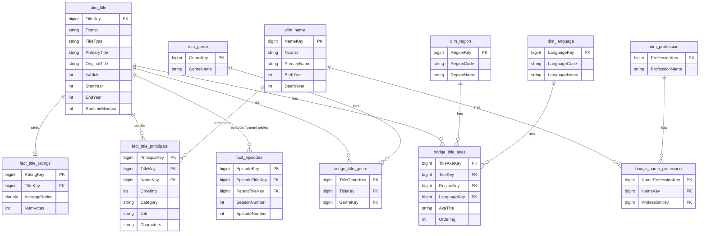

# IMDb Analytics Platform

**An end-to-end BI platform over IMDb's non-commercial datasets**, built on a Bronze → Silver → Gold medallion architecture in Databricks with Delta Live Tables. It processes **200.28M records from 7 source files** into a star schema for movie and personnel analytics, with **60 data-quality rules** enforced on every load.

**Course:** DAMG 7370, Designing Data Architecture for Business Intelligence, Northeastern University (team project, December 2025)

## Contents

- [Architecture](#architecture)
- [Data sources](#data-sources)
- [Data quality](#data-quality)
- [Data model](#data-model)
- [Business requirements](#business-requirements)
- [Repository layout](#repository-layout)
- [Running the pipeline](#running-the-pipeline)
- [Team](#team)

## Architecture

```
IMDb TSV files ──► Bronze (7 brz_* tables) ──► Silver (7 slv_* tables) ──► Gold (12 tables) ──► Power BI
  200.28M rows       raw, as-is                 typed + 60 drop rules        star schema
```

| Layer | What happens | Code |
|---|---|---|
| **Profiling** | Each source file profiled for nulls, keys, formats and value domains (Alteryx workflows and a Databricks notebook) before any modelling | `profiling/` |
| **Bronze** | Each TSV loaded as-is (header, tab separator) and tagged with `_source_file` | `pipeline/imdb_dlt_pipeline.ipynb` |
| **Silver** | Types standardised and rules applied with `@dlt.expect_all_or_drop`. Adds `DI_JOB_ID` and `DI_LOAD_DT` audit columns | same notebook |
| **Gold** | 6 dimensions, 3 facts and 3 bridge tables with surrogate keys. Audit columns carried through | same notebook |
| **Reporting** | Power BI connected to the Gold layer through the Databricks connector | not in this repo |

| Component | Technology |
|---|---|
| Data modelling | ER Studio |
| Data profiling | Alteryx, Databricks (PySpark) |
| Pipeline framework | Delta Live Tables |
| Storage | Delta Lake on Databricks |
| Visualisation | Power BI |

## Data sources

From [IMDb Non-Commercial Datasets](https://developer.imdb.com/non-commercial-datasets/). Row counts are from the profiling notebook.

| File | Contents | Rows | Key |
|---|---|---:|---|
| `name.basics.tsv` | People: name, birth and death year, professions | 14,903,875 | `nconst` |
| `title.basics.tsv` | Titles: type, names, years, runtime, genres | 12,095,664 | `tconst` |
| `title.akas.tsv` | Alternate titles by region and language | 54,124,127 | `titleId` + `ordering` |
| `title.crew.tsv` | Directors and writers per title | 12,095,664 | `tconst` |
| `title.episode.tsv` | Episodes with parent series, season and episode number | 9,324,110 | `tconst` |
| `title.principals.tsv` | Principal cast and crew credits | 96,132,477 | `tconst` + `ordering` |
| `title.ratings.tsv` | Average rating and vote count | 1,605,649 | `tconst` |
| **Total** | | **200,281,566** | |

## Data quality

The Silver layer enforces **60 rules** with `@dlt.expect_all_or_drop`. A row that fails any rule is dropped, and the pipeline's event log records how many rows each rule removed.

| Rule type | Count | Examples |
|---|---:|---|
| Completeness | 28 | Primary keys and required fields not null or empty |
| Format | 18 | IDs start with `nm` / `tt` and are 9–10 characters long |
| Range | 9 | Birth and death year 1000–2025, ordering ≥ 1, season and episode ≥ 0, rating 1–10, at least 5 votes |
| Domain | 3 | `titleType`, `category` and `isOriginalTitle` within their allowed values |
| Cross-field | 2 | Death year not before birth year; an episode isn't its own parent |

| Table | Rules |
|---|---:|
| `slv_name_basics` | 8 |
| `slv_title_basics` | 7 |
| `slv_title_akas` | 9 |
| `slv_title_crew` | 4 |
| `slv_title_episode` | 11 |
| `slv_title_principals` | 12 |
| `slv_title_ratings` | 9 |

In the team's run, the rules dropped **646 of 200,281,566 rows (0.0003%)**, mainly for invalid dates, null keys and format violations.

**Audit columns:** Bronze tables carry `_source_file`. Silver and Gold tables carry `DI_JOB_ID` (the load step) and `DI_LOAD_DT` (the load timestamp).

## Data model

The Gold layer is a star schema: 3 facts, 6 dimensions and 3 bridge tables for the many-to-many relationships. Every table has a surrogate key, and the natural IMDb IDs (`Tconst`, `Nconst`) are kept for lineage.



Row counts from the team's run:

| Table | Rows | | Table | Rows |
|---|---:|---|---|---:|
| `fact_title_principals` | 96M | | `dim_name` | 14.9M |
| `fact_episodes` | 9.3M | | `dim_title` | 12M |
| `fact_title_ratings` | 1.6M | | `dim_region` | 252 |
| `bridge_title_akas` | 54M | | `dim_language` | 111 |
| `bridge_name_profession` | 35M | | `dim_profession` | 46 |
| `bridge_title_genre` | 24M | | `dim_genre` | 28 |

The full source-to-target mapping is in [`design/source_to_target_mapping.xlsx`](design/source_to_target_mapping.xlsx), and the ER Studio model is [`design/imdb_data_model.DM1`](design/imdb_data_model.DM1).

## Business requirements

The Gold layer was designed to answer 15 analyst questions:

1. Professions for a given person
2. People with multiple professions
3. Genres for a given title
4. Movies in a given genre
5. Movies released in a given year
6. Movie length by release year
7. Adult and non-adult movies
8. Languages for a title
9. Release regions for a movie
10. Directors and writers for a movie
11. Episodes per season for a series
12. Cast and crew types for a title
13. Jobs for a title
14. Characters for a title
15. Top-rated movies by year and genre

The team built five Power BI dashboards on top of the Gold layer: Movie Insights, Crew Analytics, Content Trends, Regional Analysis and Series Insights. The Power BI report isn't included in this repo.

## Repository layout

```
imdb-analytics-platform/
├── pipeline/
│   └── imdb_dlt_pipeline.ipynb       # Delta Live Tables source: Bronze, Silver, Gold
├── profiling/
│   ├── data_profiling.ipynb          # Databricks profiling of all 7 files (outputs saved)
│   └── alteryx/                      # One Alteryx profiling workflow per source file
│       ├── name_basics.yxmd
│       ├── title_akas.yxmd
│       ├── title_basics.yxmd
│       ├── title_crew.yxmd
│       ├── title_episode.yxmd
│       ├── title_principals.yxmd
│       └── title_ratings.yxmd
└── design/
    ├── source_to_target_mapping.xlsx # Column-level mapping, source to Gold
    └── imdb_data_model.DM1           # ER Studio data model
```

## Running the pipeline

You need a Databricks workspace with Unity Catalog, plus Power BI Desktop for reporting.

1. **Download the source files** and unzip them:
   ```bash
   for f in name.basics title.basics title.akas title.crew title.episode title.principals title.ratings; do
     curl -O https://datasets.imdbws.com/$f.tsv.gz
   done
   gunzip *.tsv.gz
   ```
2. **Upload the seven `.tsv` files** to the Unity Catalog volume `/Volumes/workspace/imdb_dw/data`, or change `DATA_PATH` at the top of the pipeline notebook.
3. **Import `pipeline/imdb_dlt_pipeline.ipynb`** into the workspace.
4. **Create a Delta Live Tables pipeline** (Workflows → Pipelines) with this notebook as its source and a target catalog and schema for the tables.
5. **Start the pipeline.** DLT builds the 26 tables in dependency order, and the pipeline UI shows each data-quality rule's pass and drop counts.
6. **Connect Power BI** to the target schema through the Databricks connector and build on the Gold tables.

`profiling/data_profiling.ipynb` runs as an ordinary notebook against the same files. The Alteryx workflows open in Alteryx Designer.

## Team

Four-person team project for DAMG 7370. This repository keeps the commit history from the team's original repo.

**Arjun Loya:** ER and dimensional modelling, Bronze ingestion, Silver-layer validation rules and data-quality checks, Gold-layer star-schema transformations, and Power BI dashboards.

IMDb data is used under IMDb's [non-commercial licence](https://developer.imdb.com/non-commercial-datasets/), for educational purposes only.
